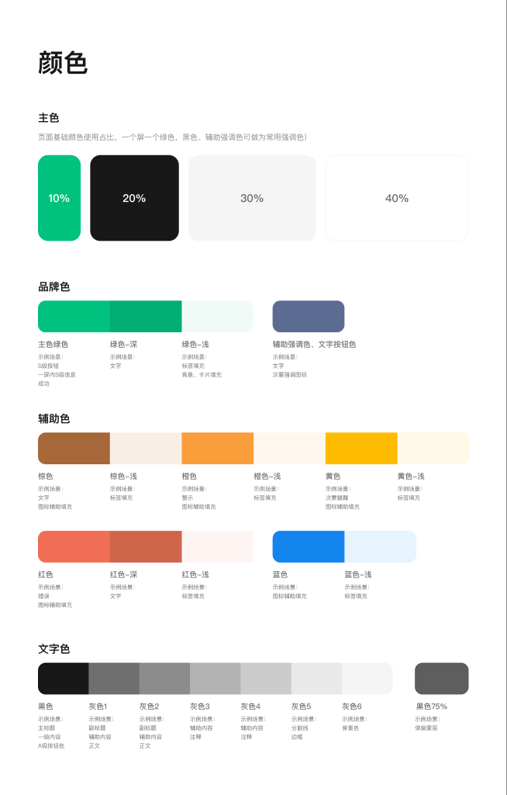
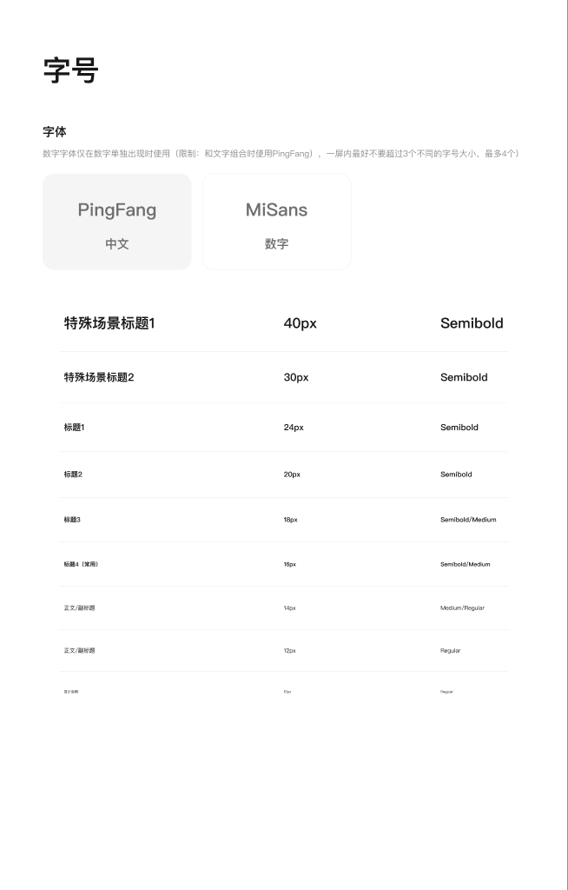
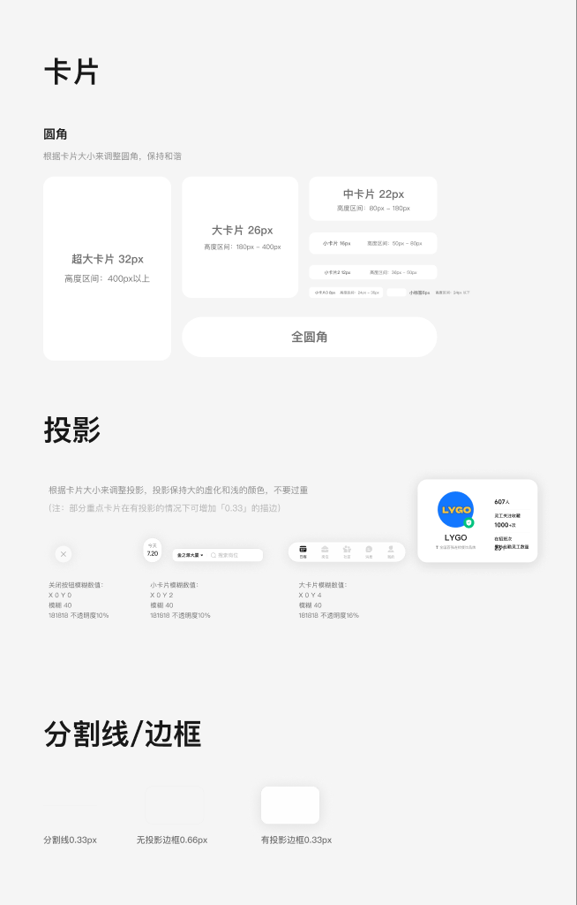
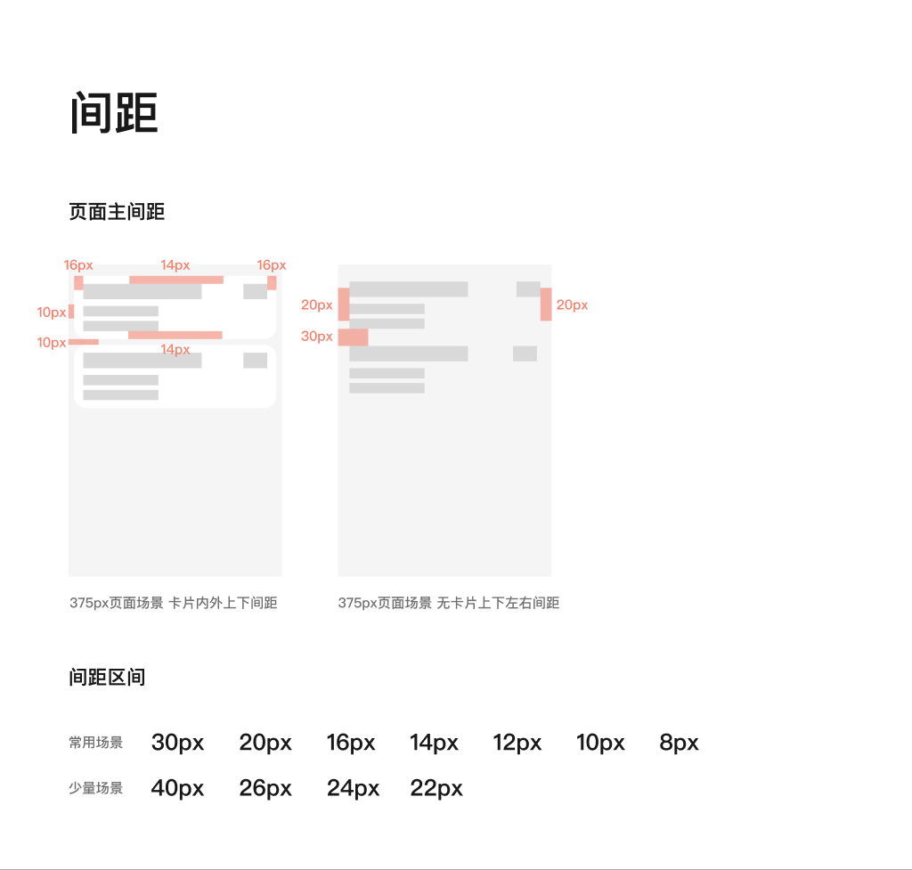

# Lygo 视觉规范

从用户指定的四个 Figma 节点迁移，读取日期：2026-11-05；原文件修订号未取得。迁移不增加新规则，不改变现有报告和评论格式。

配套 [精确数值](visual-tokens.json) 与本文件共同读取。示例图是来源证据，不能仅凭截图估算精确数值。原 Figma 后续变更不会自动同步到 GitHub；迁移后以本仓库发布的标准为检查基准。

## VIS-COLOR-001 颜色及角色

一个屏一个绿色，黑色、辅助强调色可作常用强调色。比例图仅为定性参考，不用像素占比判定不符合。

主色绿色用于 S级按钮、一屏内S级信息、成功；深绿色用于文字；浅绿色用于标签填充、背景和卡片填充；辅助强调色用于文字和次要强调图标。红色表示错误，橙色表示警示，其他辅助色用于图标或标签等源图所示角色。黑色用于主标题、一级内容、A级按钮；灰1/灰2用于副标题、辅助内容、正文；灰3/灰4用于辅助内容和注释；灰5用于分割线/边框；灰6用于背景；黑色75%用于弹窗蒙层。灰4的既有替代要求继续暂缓。

| 名称 | 色值 | 不透明度 |
| --- | --- | --- |
| 主色绿色 | #00C27E | 100% |
| 辅助强调色、文字按钮色 | #5C6B92 | 100% |
| 红色 | #F06D56 | 100% |
| 蓝色 | #1485EE | 100% |
| 橙色 | #FA9D3B | 100% |
| 灰色2 | #8C8C8C | 100% |
| 棕色 | #A66838 | 100% |
| 黑色 | #181818 | 100% |
| 黑色75% | #181818 | 70% |
| 黄色 | #FFBB00 | 100% |
| 灰色4 | #CCCCCC | 100% |
| 灰色6 | #F5F5F5 | 100% |
| 绿色-深 | #00AE74 | 100% |
| 绿色-浅 | #F0FBF7 | 100% |
| 红色-浅 | #FEF5F3 | 100% |
| 红色-深 | #CF654B | 100% |
| 蓝色-浅 | #E7F3FD | 100% |
| 橙色-浅 | #FFF6ED | 100% |
| 灰色3 | #B2B2B2 | 100% |
| 棕色-浅 | #F9EEE5 | 100% |
| 灰色1 | #6F6F6F | 100% |
| 黄色-浅 | #FFF9E8 | 100% |
| 灰色5 | #E9E9E9 | 100% |

来源：[颜色](https://www.figma.com/design/IIiYDm2xJFM57rNg1k5RCy?node-id=166-6498)。

## VIS-FONT-001 字体

中文 PingFang；独立数字 MiSans；数字与文字组合时使用 PingFang。数字专用字体只在数字单独出现时使用。

## VIS-FONT-002 字号与字重

单屏最好不超过3种字号，最多4种。

| 用途 | 字号 | 字重 |
| --- | --- | --- |
| 特殊场景标题1 | 40px | Semibold |
| 特殊场景标题2 | 30px | Semibold |
| 标题1 | 24px | Semibold |
| 标题2 | 20px | Semibold |
| 标题3 | 18px | Semibold/Medium |
| 标题4（常用） | 16px | Semibold/Medium |
| 正文/副标题 | 14px | Medium/Regular |
| 正文/副标题 | 12px | Regular |
| 提示说明 | 10px | Regular |

来源：[字号](https://www.figma.com/design/IIiYDm2xJFM57rNg1k5RCy?node-id=166-6582)。图例标签本身的显示字号不能替代标签明文指定的字号。

## VIS-CARD-001 卡片圆角

根据卡片大小调整圆角，保持和谐；全圆角为来源提供的另一种形式。以下是来源明文，受下方冲突项限制：

| 高度 | 圆角 | 状态 |
| --- | --- | --- |
| 400px以上 | 32px | 来源冲突，暂不判定 |
| 180px–400px | 26px | 按适用条件检查 |
| 80px–180px | 22px | 来源冲突，暂不判定 |
| 50px–80px | 16px | 按适用条件检查 |
| 36px–50px | 12px | 按适用条件检查 |
| 24px–36px | 8px | 按适用条件检查 |
| 24px以下 | 6px | 按适用条件检查 |

**冲突记录，未自行裁决：**
- 超大卡片明文32px，对应样例属性30px。
- 中卡片明文22px，分割线/边框区同为105px高的卡片样例属性20px。
- 相邻区间端点如80、180、400px的归属未单独定义；边界冲突时暂不判定。

## VIS-SHADOW-001 投影

根据卡片大小调整投影，保持大虚化和浅颜色，不要过重。大卡片：X0/Y4/模糊40/#181818/16%；小卡片：X0/Y2/模糊40/#181818/10%；关闭按钮：X0/Y0/模糊40/#181818/10%。来源任意其他示例参数不自动成为全局要求；若对应示例与明文冲突，保留双方并暂不判定。

## VIS-STROKE-001 分割线和边框

分割线0.33px；无投影边框0.66px；有投影边框0.33px。部分重点卡片有投影时“可”增加0.33px描边，保留建议性。飞书规则存在0.35px Gray4重点描边表述，涉及同一适用条件时不自行选择优先级。

来源：[卡片、投影、分割线、边框](https://www.figma.com/design/IIiYDm2xJFM57rNg1k5RCy?node-id=166-6630)。

## VIS-SPACE-001 间距

常用：30/20/16/14/12/10/8px；少量场景：40/26/24/22px。

375px页面场景图示：有卡片时页面左右10px、卡片内左右16px、上下14px；无卡片时左右20px、上下30px。此为场景示例，不提升为所有页面的硬性数值；固定页面边距要求按既有约定继续暂缓。

来源：[间距](https://www.figma.com/design/IIiYDm2xJFM57rNg1k5RCy?node-id=166-6752)。

